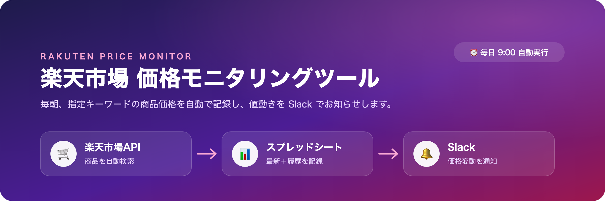
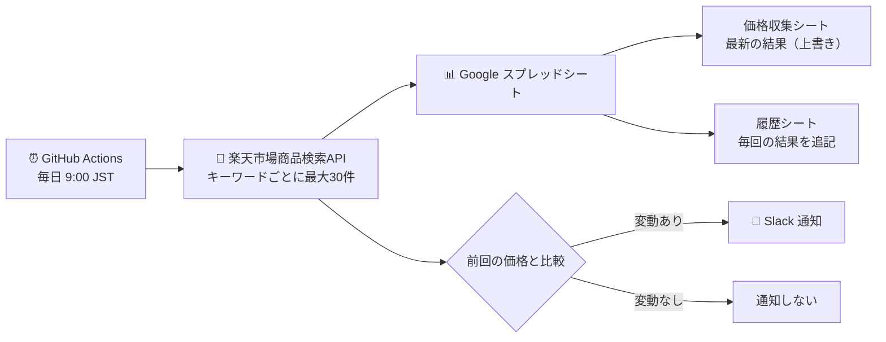
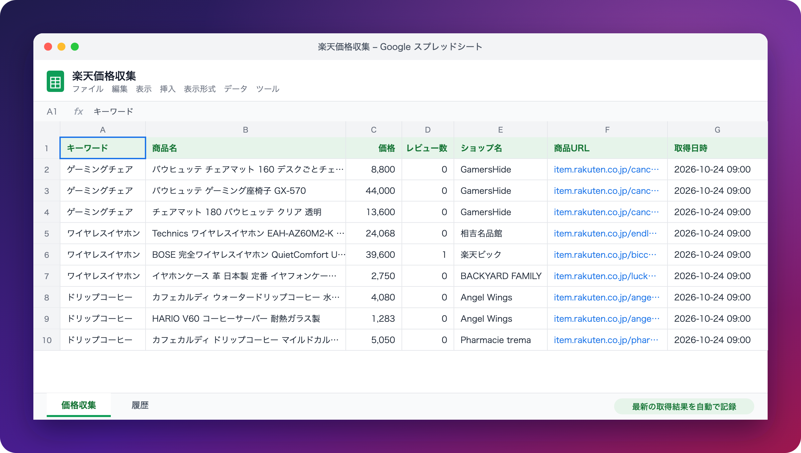
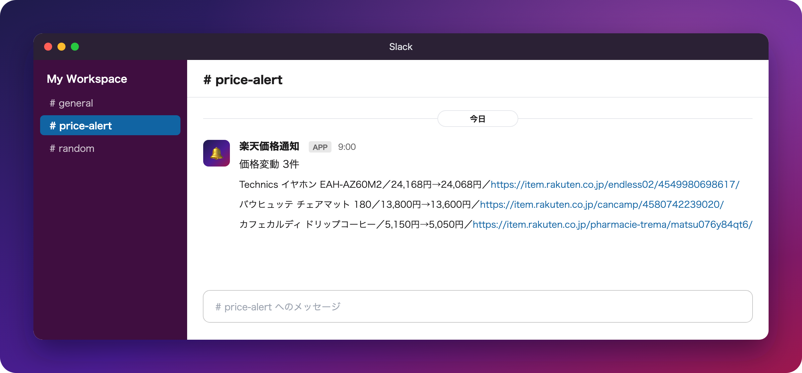

# 楽天市場 価格モニタリングツール



楽天市場の商品を指定キーワードで定期的に検索し、価格・レビュー数などを Google スプレッドシートに自動記録するツールです。
前回の取得時から価格が変わった商品があれば、Slack に通知します。

## 主な機能

- **商品データの自動収集**：楽天ウェブサービスの公式API（楽天市場商品検索API）を使用し、複数キーワードの検索結果を取得
- **スプレッドシートへの記録**：最新の取得結果と、全期間の履歴を別シートに保存
- **価格変動の検知と通知**：前回から価格が変わった商品だけを抽出し、Slack に通知（変動がなければ通知しません）
- **毎日の自動実行**：GitHub Actions により毎朝 9:00（日本時間）に実行。サーバーの用意は不要です
- **安定稼働への配慮**：一部のキーワードで取得に失敗しても処理は継続。API のアクセス制限時は自動で再試行します

## 処理の流れ



## 出力イメージ

### Google スプレッドシート

取得した商品データが、自動でスプレッドシートに記録されます。



### Slack 通知

前回から価格が変わった商品だけが、Slack に通知されます。



<sub>※ 画面はイメージです。実際の表示は環境により異なります。</sub>

## 動作環境

- Python 3.10 以上
- 楽天ウェブサービスのアカウント（楽天会員）
- Google アカウント（Google Cloud / Google スプレッドシート）
- Slack ワークスペース（通知を使う場合）
- GitHub アカウント（自動実行を使う場合）

## ファイル構成

```
.
├── main.py                     # 本体（取得・記録・変動検知・通知）
├── requirements.txt            # 依存ライブラリ
├── .env.example                # 設定ファイルのひな形
├── .github/workflows/daily.yml # 毎日の自動実行（GitHub Actions）
├── docs/images/                # README 用の画像
└── README.md
```

---

## セットアップ

### 1. 楽天ウェブサービスの登録

1. [Rakuten Developers](https://webservice.rakuten.co.jp/) に楽天会員でログイン
2. 「アプリID発行」から新規アプリを登録
   - **APIアクセススコープ**：「楽天市場API」を選択
   - **許可されたWebサイト**：`github.com`（`main.py` の `ORIGIN` と一致させます）
3. 発行された **アプリケーションID** と **アクセスキー** を控える

### 2. Google Cloud の準備（サービスアカウント）

スプレッドシートへの書き込みには、Google Cloud のサービスアカウント（ツール専用のアカウント）を使用します。

1. [Google Cloud Console](https://console.cloud.google.com/) でプロジェクトを作成
2. 「APIとサービス」→「ライブラリ」で **Google Sheets API** と **Google Drive API** を有効化
3. 「IAMと管理」→「サービスアカウント」→「サービスアカウントを作成」（ロールの付与は不要）
4. 作成したサービスアカウントの「鍵」タブ →「鍵を追加」→「新しい鍵を作成」→ **JSON**
5. ダウンロードした JSON ファイルを、プロジェクト直下に `service_account.json` という名前で配置

<details>
<summary>gcloud コマンドで行う場合</summary>

```bash
PID=scraping-rakuten-$(date +%m%d%H%M)
gcloud projects create $PID
gcloud services enable sheets.googleapis.com drive.googleapis.com --project=$PID
gcloud iam service-accounts create rakuten-sheets --project=$PID
gcloud iam service-accounts keys create service_account.json \
  --iam-account=rakuten-sheets@$PID.iam.gserviceaccount.com
```

</details>

### 3. スプレッドシートの準備

1. 記録先の Google スプレッドシートを新規作成
2. 右上の「共有」から、サービスアカウントのメールアドレスを **編集者** として追加
   - メールアドレスは `service_account.json` 内の `client_email`（`xxx@<プロジェクトID>.iam.gserviceaccount.com`）
3. スプレッドシートの URL から **スプレッドシートID** を控える
   - `https://docs.google.com/spreadsheets/d/<スプレッドシートID>/edit`

「価格収集」「履歴」シートは初回実行時に自動作成されます。

### 4. Slack Webhook の発行（通知を使う場合）

1. [Slack API: Your Apps](https://api.slack.com/apps) →「Create New App」→「From scratch」
2. アプリ名と通知先のワークスペースを選択して作成
3. 左メニュー「Incoming Webhooks」をオンにする
4. 「Add New Webhook to Workspace」→ 通知先チャンネルを選択して許可
5. 表示された Webhook URL（`https://hooks.slack.com/services/...`）を控える

### 5. 設定ファイル（.env）の作成

```bash
cp .env.example .env
```

`.env` を開き、各項目を入力します。

| 項目 | 内容 | 必須 |
|---|---|---|
| `RAKUTEN_APP_ID` | 楽天のアプリケーションID | ○ |
| `RAKUTEN_ACCESS_KEY` | 楽天のアクセスキー（`pk_` で始まる） | ○ |
| `SPREADSHEET_ID` | 記録先スプレッドシートのID | ○ |
| `SHEET_NAME` | 最新結果を書き込むシート名（初期値：`価格収集`） | ○ |
| `SERVICE_ACCOUNT_JSON` | サービスアカウントの JSON ファイルのパス（初期値：`service_account.json`） | ○ |
| `SLACK_WEBHOOK_URL` | Slack の Webhook URL。空欄の場合は通知しません | |

### 6. インストールと実行

```bash
python3 -m venv .venv
source .venv/bin/activate        # Windows: .venv\Scripts\activate
pip install -r requirements.txt
python main.py
```

<details>
<summary>Windows（PowerShell）の場合</summary>

```powershell
python -m venv .venv
.venv\Scripts\Activate.ps1
pip install -r requirements.txt
python main.py
```

実行ポリシーのエラーが出る場合は、先に `Set-ExecutionPolicy -Scope CurrentUser RemoteSigned` を一度実行してください。

</details>

実行すると、次のように結果が表示されます。

```
[OK] ゲーミングチェア: 30件
[OK] ワイヤレスイヤホン: 30件
[OK] ドリップコーヒー: 30件
価格変動: 0件
```

---

## 毎日の自動実行（GitHub Actions）

`.github/workflows/daily.yml` により、毎日 **9:00（日本時間）** に自動実行されます。

### Secrets の登録

リポジトリの「Settings」→「Secrets and variables」→「Actions」→「New repository secret」から、以下を登録します。

| Name | 値 |
|---|---|
| `RAKUTEN_APP_ID` | 楽天のアプリケーションID |
| `RAKUTEN_ACCESS_KEY` | 楽天のアクセスキー |
| `SPREADSHEET_ID` | スプレッドシートID |
| `SHEET_NAME` | `価格収集` |
| `SLACK_WEBHOOK_URL` | Slack の Webhook URL（通知を使わない場合は登録不要） |
| `SERVICE_ACCOUNT_JSON` | `service_account.json` の**中身全体**（`{` から `}` まで） |

<details>
<summary>GitHub CLI で登録する場合</summary>

```bash
gh secret set RAKUTEN_APP_ID
gh secret set RAKUTEN_ACCESS_KEY
gh secret set SPREADSHEET_ID
gh secret set SHEET_NAME --body "価格収集"
gh secret set SLACK_WEBHOOK_URL
gh secret set SERVICE_ACCOUNT_JSON < service_account.json
```

値を指定していないコマンドは、実行後に入力を求められます。

</details>

### 手動での実行

リポジトリの「Actions」タブ →「daily」→「Run workflow」から、任意のタイミングで実行できます。

---

## カスタマイズ

| 変更したい内容 | 変更箇所（`main.py`） |
|---|---|
| 検索キーワード | `KEYWORDS` |
| 1キーワードあたりの取得件数（1〜30） | `fetch_rakuten()` の `hits` |
| 並び順（初期値：更新日時の新しい順） | `fetch_rakuten()` の `sort` |
| 実行時刻 | `.github/workflows/daily.yml` の `cron`（UTC で指定。日本時間 − 9時間） |

## 仕様・注意事項

- **価格変動の判定**：前回の「価格収集」シートと商品URLで照合し、価格が異なる商品を変動として扱います。前回の結果に含まれていない商品は判定の対象外です
- **取得件数**：楽天APIの仕様により、1キーワードあたり最大30件です
- **取得失敗時**：失敗したキーワードは前回のデータを保持し、次回の比較に使用します。他のキーワードの処理は継続します
- **API への負荷対策**：キーワードごとに1秒の間隔を空けています。アクセス制限（HTTP 429）を受けた場合は、待機して最大3回まで再試行します
- **実行時刻のずれ**：GitHub Actions の定時実行は、混雑状況により数分〜数十分遅れることがあります
- **自動実行の停止**：リポジトリに60日間更新がない場合、GitHub により定時実行が自動停止されることがあります。「Actions」タブから再開できます
- **秘密情報の管理**：`.env` と `service_account.json` は `.gitignore` で除外しています。リポジトリにはコミットしないでください
- **利用規約**：取得したデータは、[楽天ウェブサービス利用規約](https://webservice.rakuten.co.jp/) の範囲内でご利用ください。スプレッドシートを不特定多数に公開することは規約で禁止されています
